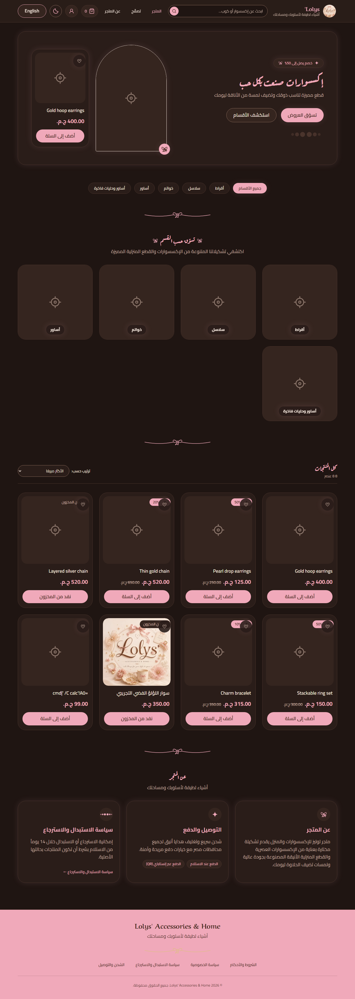
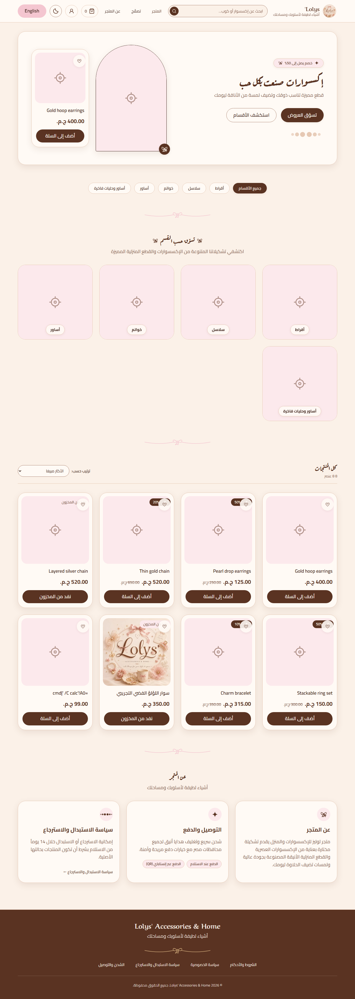
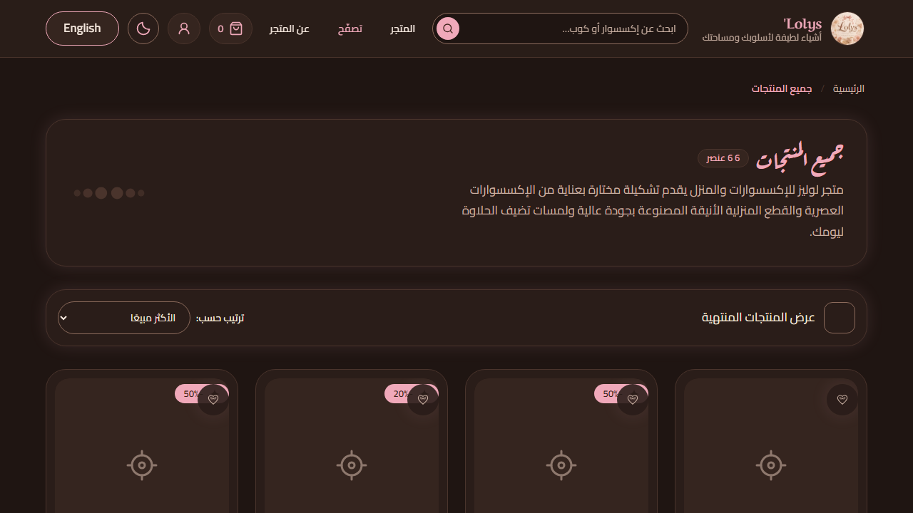
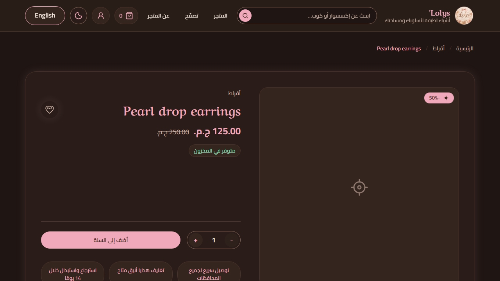
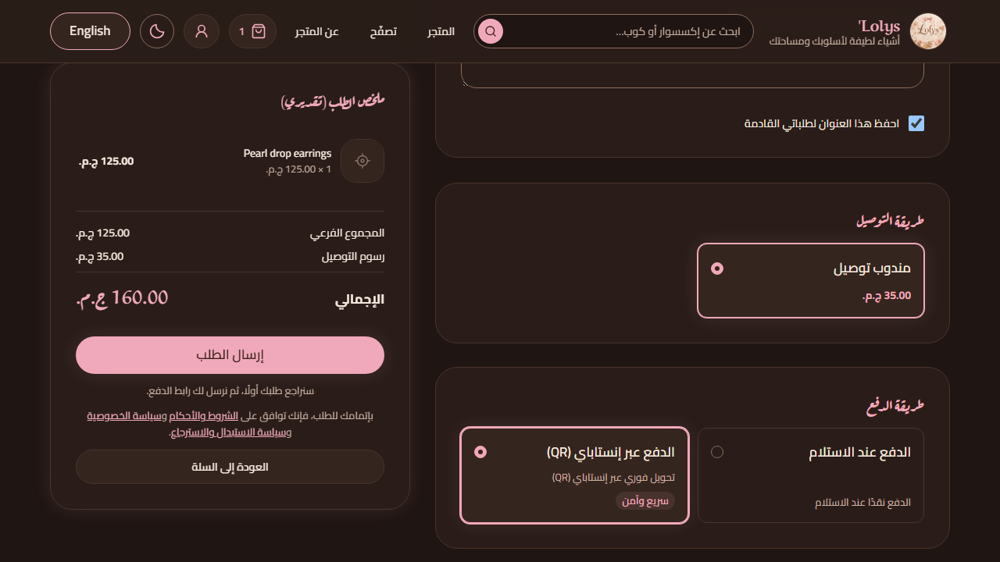
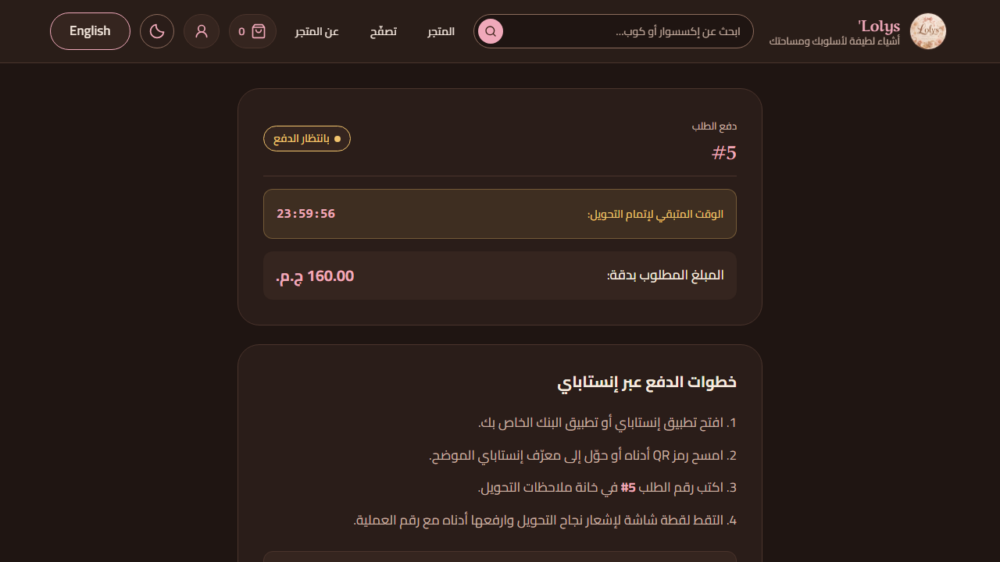
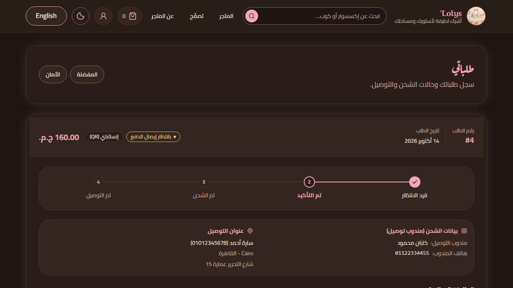
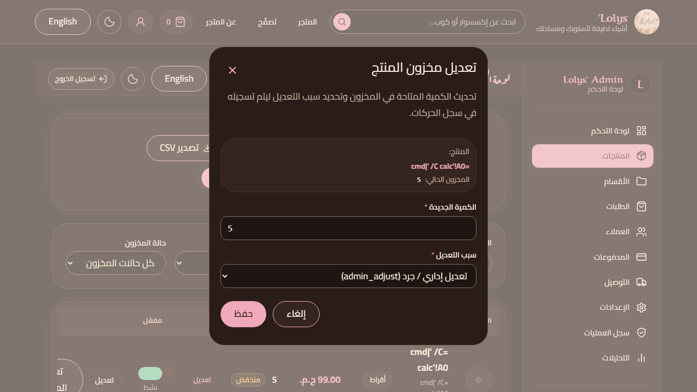
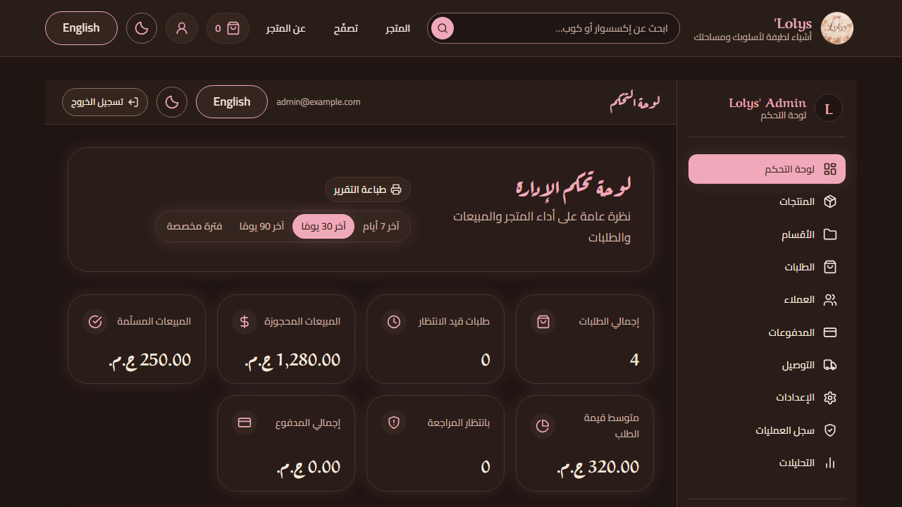

# Lolys' Accessories & Home — Project Finale

**Project:** Lolys' Accessories & Home 
**Repository:** `HassanG04/ecommerce-lolys-shop` 
**Product:** Arabic-first accessories and home shop for customers in Egypt 
**Completion record:** 29 October 2026

## What was delivered

Lolys is a bilingual, responsive e-commerce storefront with a Supabase-backed
admin workspace. Customers can browse accessories and mugs, search products,
save favourites, manage a cart, create an account, save delivery details and
place cash-on-delivery or approval-first InstaPay orders.

The admin workspace covers products, categories, stock, delivery fees, orders,
customers, payment review, audit logs, notifications, suggestions, wishlist
demand, analytics, forecasts, occasion reminders and CSV exports. The homepage
and bilingual footer/policy content can be edited by an authenticated admin.

The final hosted feature check returned all eleven values as `true`:

| Hosted capability                    | Result    |
| ------------------------------------ | --------- |
| Profile photos                       | Installed |
| Row-level security on checked tables | Enabled   |
| Customer suggestions                 | Installed |
| Forecast CSV function                | Installed |
| Customer notifications               | Installed |
| Storefront editor                    | Present   |
| Wishlist-demand reporting            | Installed |
| Admin occasion reminders             | Installed |
| Order postal-code guard              | Enabled   |
| Profile postal-code guard            | Enabled   |
| Private payment-proof storage        | Preserved |

The hosted database installer was designed to preserve existing customer
accounts, real orders, payment settings and homepage content. It was rehearsed
on a disposable schema-only local database before the owner applied it to
Supabase Cloud.

## Product experience

- Arabic and English translations with automatic RTL/LTR layout direction.
- Light and dark themes with a smooth transition.
- Responsive storefront and admin navigation for desktop and mobile.
- Loading skeletons, page and section transitions, hover elevation, product
  image emphasis, magnetic pointer interactions and accessible focus states.
- Pink flower purchase buttons and a warm, cozy visual language built from the
  documented design tokens.
- Password visibility, copy and secure-password generation controls.
- Password strength checks that reject trivial numeric and keyboard sequences.
- Recovery, email verification, TOTP enrollment and admin step-up flows.
- Saved address support with a five-digit postal code for complete addresses.
- Homepage controls for the hero, featured item, promotional copy, categories
  and policy/footer content.

## Order and payment flow

The database controls the commercial rules. The browser never supplies the
authoritative price, stock, delivery fee, order total or payment status.

1. The customer submits an order request.
2. The owner reviews and approves the request.
3. The customer receives the configured InstaPay QR and payment instructions.
4. The customer transfers the exact amount and uploads a private payment proof.
5. The owner reviews the order number, transfer information and proof.
6. The owner marks the payment as accepted and fulfils the order.

The approved InstaPay recipient is configured as `alaa.ahm9624@instapay`.
Payment proofs stay in a private storage bucket and are never public catalogue
media.

## Cloud architecture

| Service or tool              | Role in the project                                                                    |
| ---------------------------- | -------------------------------------------------------------------------------------- |
| Cloudflare Pages             | Hosts the Vite frontend and SPA routes.                                                |
| Supabase Cloud               | Provides Auth, PostgreSQL, RLS, Storage and database functions.                        |
| Supabase Auth                | Email verification, password recovery, sessions and TOTP MFA.                          |
| Cloudflare Turnstile         | Bot challenge on registration, login and recovery flows.                               |
| GitHub Actions               | CI, database checks, browser tests, security checks and the manual analytics workflow. |
| Docker + Supabase CLI        | Isolated local Postgres, Storage and Auth environments for testing.                    |
| Git and GitHub pull requests | Branch-based implementation, review and handoff history.                               |

Production credentials and dashboard changes remained owner-controlled. Secret
values were not read, printed or committed. The browser uses only the public
Supabase client key; the service-role key is never placed in frontend code.

## Frontend tools

- React with strict TypeScript.
- Vite for development and production builds.
- Tailwind CSS and the documented Lolys design tokens.
- React Router for storefront, account and admin routes.
- TanStack Query for server state, cache invalidation and loading states.
- i18next and react-i18next for Arabic/English language parity.
- Zod for typed input validation.
- Recharts for admin analytics visualisations.
- Supabase JavaScript client for Auth, Storage and database RPC calls.
- Vitest and Testing Library for component and feature behavior.
- Playwright and axe-core for browser journeys and accessibility checks.
- ESLint, Prettier, TypeScript compiler and bundle-budget tooling.

The application is organized in feature folders. Supabase calls are kept in
feature API modules or shared library code, while UI components remain focused
on rendering and interaction.

## Supabase, PostgreSQL and SQL work

The database is the authority for commerce and security rules.

- Append-only migrations define tables, types, indexes, triggers and RPCs.
- RLS is enabled on public tables and new tables ship with explicit grants.
- `place_order` creates orders atomically and checks current database prices,
  stock, delivery fees and limits.
- Payment review, order approval, fulfilment and stock restoration are database
  operations with audit evidence.
- Postal-code triggers protect new orders and newly changed complete addresses
  without inventing data for historical orders.
- Profile photo storage validates ownership, path format, file size and image
  formats.
- Customer notifications, suggestions, wishlist demand and occasion reminders
  have owner-scoped policies and admin MFA gates.
- The homepage editor uses a validated bilingual JSON document and revision
  checks so one admin cannot silently overwrite another admin's newer edit.
- InstaPay settings are private and validated before they can affect payment
  instructions or QR generation.
- The hosted repair included runtime drift guards, transaction rollback and
  preservation checks for the existing editor, payment and MFA functions.

Database verification used pgTAP, concurrency checks, generated TypeScript
types, RLS assertions, permission tests, migration checks and SQL safety checks.

## Security and privacy

The security model treats the browser as untrusted.

- Admin policies and sensitive RPCs require a database-enforced `aal2` session.
- The owner is the only actor who promotes an account to an admin role.
- Login, registration and recovery responses remain generic to limit account
  enumeration.
- Turnstile and Supabase rate limits reduce automated login abuse.
- Passwords require at least ten characters and reject common trivial patterns.
- Password reset links are single-use and expire through the Auth flow.
- Uploads accept JPEG, PNG or WebP only, with size and path restrictions.
- Payment proofs remain private and use owner-authorized access.
- CSP, HSTS, frame protections, content-type protections and permissions headers
  protect the deployed frontend.
- Raw backend errors never reach the user interface. Errors map to stable
  catalogue codes and friendly Arabic messages.
- Audit logs record sensitive admin actions.
- Analytics uses aggregate data and excludes names, phones, addresses and user
  identifiers.
- Dependency, secret, static-analysis and supply-chain checks run in CI.

## Analytics, data collection and machine learning

The project does **not** use Gemini, ChatGPT or another LLM to set prices or make
automatic business decisions. The analytics package is deterministic Python
software with explicit readiness gates, backtesting and human review.

### Data collected for analysis

The aggregate analytics layer can use:

- daily units, revenue and order counts;
- product and category identifiers;
- historical average unit revenue and discounts;
- stock and stock-out signals;
- wishlist counts without customer identities;
- delivery, payment and fulfilment outcomes in aggregate;
- calendar features such as Ramadan, Eid, Mother's Day, Valentine's Day,
  Black Friday and back-to-school periods.

Names, phone numbers, addresses, email addresses and customer identifiers are
excluded from the analytics dataset.

### Models and safeguards

- Seasonal-naive and moving-average baselines are always calculated first.
- AutoETS/AutoTheta-style statistical models cover suitable shop and category
  series.
- Croston SBA, TSB and ADIDA cover intermittent product demand.
- An optional global gradient-boosting model is gated and disabled by default.
- Rolling-origin backtests compare WAPE, MASE, pinball loss, bias and interval
  coverage.
- Forecasts must be finite, non-negative and within sanity bounds.
- Poorly performing series fall back to the baseline.
- Forecasts never change prices, stock, orders or payment decisions.

The admin CSV export becomes ready after **56 days since the first qualifying
sale and at least 30 qualifying orders**. Category and product views have
stricter gates. Until those conditions are met, the download can remain
disabled with a clear “not enough data yet” state.

The Python stack uses NumPy, pandas, SciPy and psycopg, with pytest, coverage
and Ruff for verification. The configured analytics workflow is manual-only
until the owner approves production activation and validates real-data accuracy.

## How the project was handled

1. The roadmap and specification files were treated as the source of truth.
2. Work was split into small feature branches with explicit task IDs.
3. Codex implemented changes; Anti-Gravity reviewed, continued and produced
   handoff reports when work crossed sessions.
4. Security-sensitive database, Auth, MFA, payment and admin changes stayed
   behind owner review.
5. Existing work was inspected before adding a new solution; duplicate repairs
   and unsafe historical migrations were avoided.
6. Every substantial change was tested locally before a pull request was
   prepared.
7. Hosted database changes were delivered as a guarded, owner-run SQL file.
   The agent did not write to the production dashboard or hosted database.
8. Progress, handovers, launch notes, runbooks and verification evidence were
   kept in the repository.

## Verification record

The final implementation checks included:

- all 12 `npm run verify` gates;
- 917 application tests;
- 208 tooling tests;
- 172 affected local database assertions for the hosted feature repair;
- rollback, preservation, duplicate-application and permission refusal tests;
- roadmap validation with 154 tasks recorded in the active branch;
- production build and UI-build checks;
- secret, bundle, migration, SQL, token, supply-chain and i18n checks;
- accessibility, security, RTL and storefront browser suites in the project
  verification history;
- analytics tests with aggregate-only data rules.

The verified initial JavaScript bundle was **199,863 / 200,000 gzip bytes** in
the final repair run. Browser performance measurements were made against local
throttled builds and must not be presented as live-site measurements.

## Portfolio gallery

The following are repository QA captures prepared for a portfolio or project
post. They show the product in Arabic RTL, dark/light themes, customer flows
and the admin workspace. Replace them with fresh production captures if a post
needs the current Cloudflare URL or real catalogue data.

### Brand

### Storefront and catalogue

### Checkout and payment

### Admin workspace

Light-theme counterparts for each QA capture are available in
[`docs/qa/rtl/`](docs/qa/rtl/).

## Portfolio description

> Lolys' Accessories & Home is a bilingual Arabic-first e-commerce experience
> built with React, strict TypeScript, Vite, Tailwind and Supabase. It combines
> a cozy responsive storefront with database-authoritative checkout, approval-
> first InstaPay payments, private proof uploads, admin MFA, RLS, audit logs,
> editable bilingual content and a privacy-preserving analytics pipeline for
> demand and stock planning.

Suggested tags: `#React` `#TypeScript` `#Supabase` `#CloudflarePages`
`#PostgreSQL` `#Ecommerce` `#Analytics` `#Accessibility` `#CyberSecurity`
`#ArabicUX` `#RTL`

## Reference documents

- [README](README.md)
- [Consolidated progress report](progress.md)
- [Roadmap](roadmap.md)
- [Database contract](database-contract.md)
- [Design system](design-system.md)
- [Security model](security-model.md)
- [Analytics plan](analytics-plan.md)
- [Hosted feature installation guide](docs/runbooks/hosted-features-2026-10-29.md)
- [Hosted feature status](docs/handoff/HOSTED-FEATURE-STATUS-2026-10-29.md)
- [Launch checklist](docs/launch-checklist.md)
