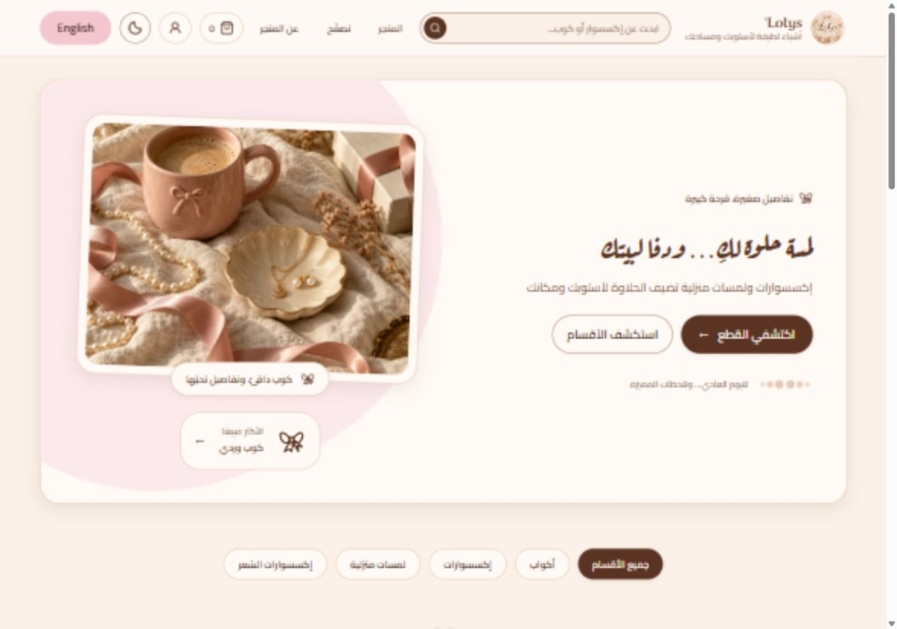

# Cozy storefront — 2026-10-15

The owner requested warmer styling, animations, loading skeletons and replacement
of the tall arch while Anti-Gravity continues the application foundations.
T-3.09 covers art direction; T-3.09b covers loading and motion.

This request supersedes the hero/category arch and automatic-motion restrictions
in the original design specification for these surfaces. Existing cream, blush,
cocoa and gold tokens, Cairo/Aref Ruqaa fonts and RTL behavior remain authoritative.

- Broad 4:3 still-life hero in a rounded photo frame; square category photography
  suits both jewelry and mugs. Captions sit below photos for stable contrast.
- Decorative generated artwork is bundled locally. It is not a catalogue item,
  an offer, or evidence of inventory. Product photos remain database-controlled.
- Public hero settings remain supported. An absent sale percentage does not
  invent a discount. English fallback copy remains English.
- Entrance animation runs once for 240ms. Hover movement is limited to devices
  with hover, at 200–220ms. Only pending skeletons pulse continuously.
- Reduced motion disables all animation and transitions. Content never depends
  on a scroll observer or animation to become available.
- Image skeletons reserve the final ratio, including eager images. A failed image
  becomes a bow seal; replacing its source retries normally. Home, category and
  search share localized loading announcements.

## Asset provenance

Generated with the built-in ImageGen tool on 2026-10-15. Web delivery variants:
`public/brand/cozy-still-life.webp` (1200×900, 180,362 bytes) and
`public/brand/cozy-still-life-small.webp` (720×540, 78,416 bytes).
The PNG original remains in the Codex generated-images directory; WebP encoding
uses Sharp without introducing a runtime dependency.

Prompt:

> Create a photorealistic editorial still life for the hero of Lolys' Accessories & Home, a warm cozy boutique. Landscape 4:3 composition. On softly rumpled ivory linen, a blush pink rounded ceramic coffee mug with a tiny embossed ribbon bow, a small cream scalloped ceramic trinket dish with a delicate gold necklace and two small pearl earrings, a loose ivory pearl strand, a softly curling blush satin ribbon, the corner of a cream gift box, one understated dried flower. Close overhead three-quarter angle, tactile ceramic glaze and linen, soft late-afternoon window light and natural shadows. Palette strictly warm cream/champagne, dusty blush pink and cocoa brown with small gold jewelry accents. Objects feel thoughtfully placed, relaxed and intimate, excellent real material detail, spacious but visually rich, elegant boutique editorial rather than glossy advertisement. Fill frame with the still life, no text, no typography, no labels, no logo, no people, no arch, no visible picture frame, no graphic UI, no collage. Decorative mood photograph, not a representation of specific stock.

## Verification

Pinned Node: 24.21.0. Evidence is local, on the isolated UI checkout based on
`7f9b21c`; no remote CI success or production-readiness claim is made.

| Check                                               | Result                                                                                                                                                                              |
| --------------------------------------------------- | ----------------------------------------------------------------------------------------------------------------------------------------------------------------------------------- |
| Dependency installation                             | `npm ci --ignore-scripts` passed; lockfile unchanged.                                                                                                                               |
| Application tests                                   | 685 passed across 59 files; zero failures.                                                                                                                                          |
| Node tooling tests                                  | 203 passed; zero failures or skips, including security scanner tests.                                                                                                               |
| Lint, formatting and TypeScript                     | Passed. Final responsive-header class changes were also formatted and rebuilt.                                                                                                      |
| Migration, SQL, token, supply-chain and i18n guards | Passed.                                                                                                                                                                             |
| Production build and UI build guard                 | Passed, including a final rebuild after header adjustments.                                                                                                                         |
| Secret scan                                         | Passed for tracked files and production output; repeated after staging new files.                                                                                                   |
| Bundle guard                                        | **FAIL: 202,391 / 200,000 gzip bytes.** Clean unchanged base independently measured 201,984 bytes. The refreshed branch adds 407 bytes; both exceed the gate.                       |
| Full `npm run verify`                               | **FAIL at bundle guard.** Its tests, build and earlier guards passed. The final header-only rebuild has the exact size above.                                                       |
| Roadmap                                             | 124 tasks validate; T-3.09 and T-3.09b deliberately remain `doing`.                                                                                                                 |
| Visual review                                       | 1280px Arabic/light and English/dark observed. 360px Arabic/light exposed header overflow; responsive layout adjusted but visual recheck pending.                                   |
| Remaining browser checks                            | Complete the full language/theme/width matrix, slow-image behavior and reduced-motion review. Further automation was denied by the browser URL security policy; no workaround used. |
| Database, e2e, live checkout/payment/authentication | Not run for this isolated visual change. No production settings or data were changed.                                                                                               |

Detailed local logs: `.tools/verify-complete.log`, `.tools/build-delivery.log`,
`.tools/bundle-delivery.log` and `.tools/baseline-build.log`. These ignored files
are local evidence, not remote CI. Review the integration notes in
`docs/handoff/COZY-STOREFRONT.md` before combining Anti-Gravity's work.

### Desktop preview

Local preview with synthetic catalogue data; the photo is decorative generated
artwork. This screenshot precedes the later compact-header and payment-badge
adjustments; the hero itself is unchanged.

