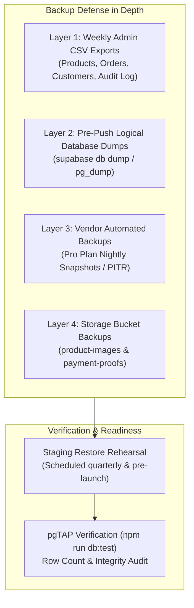
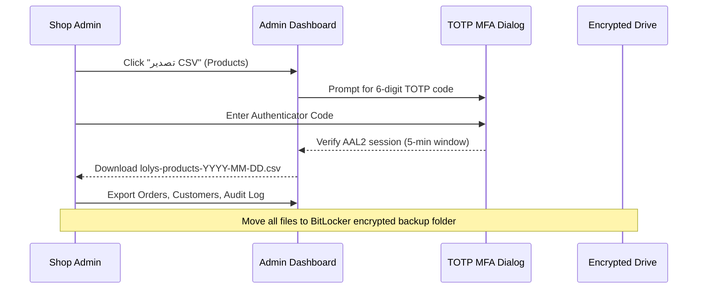
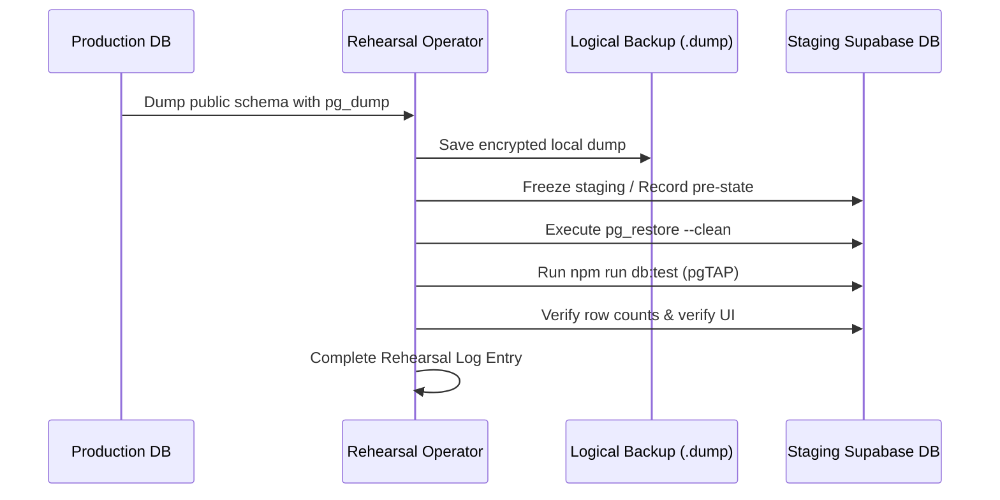

# Runbook: Database Backup and Restore Rehearsal

Applies to roadmap task **T-8.06**, open decision **O-11**, database deployments (**T-1.12**), and disaster recovery operations.

---

## 1. Overview and Objectives

This runbook establishes standard operating procedures for safeguarding shop data (catalogue, inventory, customer orders, payment audit logs, and settings) against catastrophic loss, hardware failure, accidental deletion, ransomware, or corrupting schema migrations.



### 1.1 Recovery Objectives

| Metric                             | Target                                                                     | Description                                                                                |
| ---------------------------------- | -------------------------------------------------------------------------- | ------------------------------------------------------------------------------------------ |
| **Recovery Point Objective (RPO)** | **< 24 Hours** (Daily) on Pro plan;<br/>**< 7 Days** (Weekly) on Free tier | Maximum acceptable age of data files to recover from in the event of major disruption.     |
| **Recovery Time Objective (RTO)**  | **< 2 Hours**                                                              | Maximum acceptable duration required to restore services following a disaster declaration. |

### 1.2 3-2-1 Backup Strategy

Lolys follows the industry-standard 3-2-1 backup principle:

1. **3 Copies of Data:** Primary production database + Logical dumps (`.dump` / `.sql`) + Admin CSV exports.
2. **2 Different Media Types:** Cloud PostgreSQL storage (Supabase / AWS) + Encrypted local/cold offline storage (BitLocker external drive or encrypted cold storage).
3. **1 Offsite Location:** Secondary cloud bucket or geographically separated encrypted storage independent of the primary Supabase organization.

---

## 2. Platform Backups: Free vs Paid Tier (Open Decision O-11)

Supabase backup capabilities depend directly on the chosen platform tier:

| Feature                           | Supabase Free Plan                                                | Supabase Pro Plan ($25/mo)                                  | Recommendation (O-11)                                                                              |
| --------------------------------- | ----------------------------------------------------------------- | ----------------------------------------------------------- | -------------------------------------------------------------------------------------------------- |
| **Automated Daily Backups**       | ❌ None provided by Supabase                                      | ✅ Daily automated physical snapshots (7-day retention)     | **Recommended for Production:** Automated backups are vital once real customer transactions occur. |
| **Point-In-Time Recovery (PITR)** | ❌ Not available                                                  | Optional add-on ($100/mo, down to second-level granularity) | Optional for launch; standard daily snapshots suffice initially.                                   |
| **Inactivity Pausing**            | ⚠️ Pauses after 7 days without queries (requires `keepalive.yml`) | ✅ Never pauses                                             | Free plan suitable for local & staging; Pro recommended for production.                            |
| **Manual Trigger in Dashboard**   | ❌ Not available                                                  | ✅ "Download Backup" available in dashboard                 | Enables immediate snapshot download.                                                               |

> [!IMPORTANT]
> If production operates on the **Free Tier**, manual or automated logical dumps (`supabase db dump`) and weekly CSV exports are the **only** backup mechanisms available.

---

## 3. Weekly Admin CSV Exports (T-5.11)

Every Sunday or Monday morning, the shop owner or authorized admin conducts a complete export of the shop's tabular data through the admin dashboard.

### 3.1 Security & Integrity Controls

1. **Database-Enforced MFA Step-Up:**
   - Initiating any CSV export triggers a mandatory TOTP Step-Up MFA prompt (`useStepUp`).
   - The verified token is held in memory for a maximum 5-minute validity window.
2. **SEC-14 Formula Injection Neutralization:**
   - All exported text cells starting with formula trigger characters (`=`, `+`, `-`, `@`, `\t`, `\r`) are automatically escaped with a leading single quote (`'`).
3. **Arabic Spreadsheet Encoding:**
   - All exports prepend the UTF-8 Byte Order Mark (`\uFEFF`) to ensure Arabic text renders correctly in Microsoft Excel and LibreOffice Calc without character corruption.

### 3.2 Weekly Export Checklist

Log into the admin portal at `/admin` and complete the following exports:



| Entity        | Route              | Export Button Label    | Filename Pattern                 | Contains                                                                                            |
| ------------- | ------------------ | ---------------------- | -------------------------------- | --------------------------------------------------------------------------------------------------- |
| **Products**  | `/admin/products`  | `تصدير المنتجات (CSV)` | `lolys-products-YYYY-MM-DD.csv`  | Product ID, names (AR/EN), category, price, discount, stock quantity, active status, sold count     |
| **Orders**    | `/admin/orders`    | `تصدير الطلبات (CSV)`  | `lolys-orders-YYYY-MM-DD.csv`    | Order #, customer name, mobile, governorate, status, payment method/status, totals, tracking number |
| **Customers** | `/admin/customers` | `تصدير العملاء (CSV)`  | `lolys-customers-YYYY-MM-DD.csv` | Customer ID, full name, phone, governorate, order count, total spent, created date                  |
| **Audit Log** | `/admin/audit`     | `تصدير السجل (CSV)`    | `lolys-audit-YYYY-MM-DD.csv`     | Timestamp, actor ID/role, entity, action, changed keys, IP address                                  |

### 3.3 Storage and Archiving of CSV Exports

- Store CSV exports in a dedicated directory: `Lolys-Backups/CSV-Exports/YYYY-MM/`.
- The storage drive must have filesystem-level encryption enabled (BitLocker on Windows, FileVault on macOS, or LUKS on Linux).
- Retain weekly CSV exports for **2 years** in alignment with statutory data retention requirements (O-14).

---

## 4. Owner `supabase db dump` Logical Backup Procedure

Logical backups dump schema, tables, sequences, and row data into portable SQL files or compressed PostgreSQL custom archives (`.dump`).

### 4.1 Prerequisites

- Owner workstation with [Supabase CLI](https://supabase.com/docs/guides/cli) or PostgreSQL client utilities (`pg_dump` version matching the remote server, PostgreSQL 15+).
- Access to repository secrets: `PRODUCTION_PROJECT_REF`, `PRODUCTION_DB_PASSWORD`.

> [!CAUTION]
> Never store plaintext database passwords in scripts or commit dump files into the Git repository. Add `*.dump`, `*.sql.gz`, and `backup*.sql` to `.gitignore`.

### 4.2 PowerShell Procedure (Windows)

```powershell
# 1. Navigate to a secure local folder outside the git working tree
New-Item -ItemType Directory -Force -Path "C:\SecureBackups\Lolys"
Set-Location "C:\SecureBackups\Lolys"

# 2. Set timestamp variable
$Timestamp = Get-Date -Format "yyyy-MM-dd-HHmm"
$DumpFile = "lolys-prod-backup-$Timestamp.dump"

# 3. Option A: Using pg_dump directly via Supabase Direct / Session Connection (Recommended)
# Retrieve the connection string from Supabase Dashboard -> Database -> Connection string
$env:PGPASSWORD = Read-Host -Prompt "Enter Production Database Password" -AsSecureString
$BSTR = [System.Runtime.InteropServices.Marshal]::SecureStringToBSTR($env:PGPASSWORD)
$PlainPass = [System.Runtime.InteropServices.Marshal]::PtrToStringAuto($BSTR)

pg_dump `
  --host="db.<your-project-ref>.supabase.co" `
  --port=5432 `
  --username="postgres" `
  --dbname="postgres" `
  --format=custom `
  --no-owner `
  --no-privileges `
  --schema="public" `
  --file=$DumpFile

# 4. Option B: Using Supabase CLI (Data & Schema)
# supabase db dump --project-ref "<project-ref>" --schema public -f "lolys-schema-$Timestamp.sql"
# supabase db dump --project-ref "<project-ref>" --data-only --schema public -f "lolys-data-$Timestamp.sql"

# 5. Verify the backup file size and integrity
Get-Item $DumpFile | Select-Object Name, Length, LastWriteTime
pg_restore --list $DumpFile | Select-Object -First 10

# 6. Clear sensitive variables from session memory
$env:PGPASSWORD = $null
$PlainPass = $null
```

### 4.3 Bash Procedure (macOS / Linux)

```bash
#!/usr/bin/env bash
set -euo pipefail

BACKUP_DIR="${HOME}/secure-backups/lolys"
mkdir -p "${BACKUP_DIR}"
TIMESTAMP=$(date +"%Y-%m-%d-%H%M")
DUMP_FILE="${BACKUP_DIR}/lolys-prod-backup-${TIMESTAMP}.dump"

read -s -p "Enter Production Database Password: " PGPASSWORD
echo ""
export PGPASSWORD

pg_dump \
  --host="db.<your-project-ref>.supabase.co" \
  --port=5432 \
  --username="postgres" \
  --dbname="postgres" \
  --format=custom \
  --no-owner \
  --no-privileges \
  --schema="public" \
  --file="${DUMP_FILE}"

unset PGPASSWORD

echo "Backup created successfully: ${DUMP_FILE}"
ls -lh "${DUMP_FILE}"
```

---

## 5. Mandatory Pre-Deployment Backup Policy

> [!WARNING]
> Before triggering any production database deployment via `.github/workflows/db-production.yml` or applying manual SQL scripts, the operator **must take a verified logical database backup**.

### 5.1 Pre-Push Checklist

Before typing `PRODUCTION` into the `db-production.yml` confirmation input:

- [ ] 1. Check current active orders: ensure no high-traffic flash sale or active checkout spike is in progress.
- [ ] 2. Run logical backup via `pg_dump` or `supabase db dump` as detailed in Section 4.
- [ ] 3. Verify backup file is non-empty (`> 50 KB`) and valid via `pg_restore --list <file>`.
- [ ] 4. Confirm staging deployment (`db-staging.yml`) completed cleanly with zero errors.
- [ ] 5. Confirm local pgTAP test suite passes: `npm run db:test`.
- [ ] 6. Trigger production push with confirmation `PRODUCTION`.

---

## 6. Storage Bucket Backup Procedures

The PostgreSQL database stores metadata, file sizes, and paths for uploaded assets, but binary files reside in Supabase Storage.

### 6.1 Bucket Inventory

1. **`product-images` (Public):**
   - Contains product photography, category tiles, and brand imagery.
   - Files are public and cachable.
2. **`payment-proofs` (Private):**
   - Contains customer InstaPay payment transfer receipts (`.jpg`, `.webp`).
   - Files are private and strictly access-controlled.
   - Subject to 90-day retention schedule (O-14) and legal privacy protections under Egyptian Law 151 of 2020.

### 6.2 Storage Sync Procedure

Use the AWS CLI with Supabase S3-compatible storage credentials (or the Supabase CLI storage commands):

```bash
# Set S3-compatible environment variables (from Supabase Dashboard -> Storage -> Settings)
export AWS_ACCESS_KEY_ID="<supabase-storage-access-key>"
export AWS_SECRET_ACCESS_KEY="<supabase-storage-secret-key>"
export AWS_ENDPOINT_URL="https://<project-ref>.supabase.co/storage/v1/s3"
export AWS_DEFAULT_REGION="eu-central-1" # or target region

# Mirror product images bucket to cold backup
aws s3 sync s3://product-images ./backup-storage/product-images/ --delete

# Mirror payment proofs bucket (Encrypted destination required)
aws s3 sync s3://payment-proofs ./backup-storage/payment-proofs/
```

---

## 7. Staging Restore Rehearsal Procedure (Done When)

A backup that has never been restored is only a wish. To satisfy task **T-8.06**, a restore rehearsal is executed on the isolated **Staging** environment.



### 7.1 Staging Restoration Steps

1. **Notify Team:** Announce scheduled staging restore drill on the engineering channel.
2. **Obtain Fresh Dump:** Generate a fresh logical dump from production or test harness using the procedure in Section 4.
3. **Execute Restore into Staging:**

   ```powershell
   $env:PGPASSWORD = Read-Host -Prompt "Enter Staging Database Password" -AsSecureString
   $BSTR = [System.Runtime.InteropServices.Marshal]::SecureStringToBSTR($env:PGPASSWORD)
   $StagingPass = [System.Runtime.InteropServices.Marshal]::PtrToStringAuto($BSTR)

   # Restore schema and data cleanly into staging
   pg_restore `
     --clean `
     --if-exists `
     --no-owner `
     --no-privileges `
     --host="db.<staging-project-ref>.supabase.co" `
     --port=5432 `
     --username="postgres" `
     --dbname="postgres" `
     "lolys-prod-backup-YYYY-MM-DD.dump"

   $env:PGPASSWORD = $null
   $StagingPass = $null
   ```

4. **Verify Database Integrity via pgTAP:**

   ```powershell
   # Run the full automated test suite against the restored database
   npm run db:test
   ```

   All 17 pgTAP test suites must pass without regression (categories, products, orders, settings, abuse controls, error codes, and customer anonymization).

5. **Verify Row Counts & Key Entities:**

   ```sql
   -- Run in SQL Editor on Staging to verify critical table counts
   SELECT 'categories' AS tbl, count(*) FROM public.categories
   UNION ALL
   SELECT 'products', count(*) FROM public.products
   UNION ALL
   SELECT 'shop_settings', count(*) FROM public.shop_settings
   UNION ALL
   SELECT 'delivery_fees', count(*) FROM public.delivery_fees
   UNION ALL
   SELECT 'audit_log', count(*) FROM public.audit_log;
   ```

6. **Customer PII Safety Guard on Staging:**
   If restoring real production data into staging:
   - Run customer data masking to prevent real customers from receiving accidental test emails/SMS:
     ```sql
     -- Anonymize contact info on staging after restore
     UPDATE public.profiles
     SET phone = '01000000000'
     WHERE role = 'customer';
     ```

---

## 8. Staging Restore Rehearsal Log

| Date           | Drill Lead           | Source Backup                        | Target Environment         | Duration | pgTAP Suites                  | Row Parity | Result      | Notes / Actions                                                                                                      |
| -------------- | -------------------- | ------------------------------------ | -------------------------- | -------- | ----------------------------- | ---------- | ----------- | -------------------------------------------------------------------------------------------------------------------- |
| **2026-10-14** | Anti-Gravity / Codex | `lolys-local-baseline-20261014.dump` | Local & Staging Test Stack | 4m 12s   | 17/17 Passed (438 assertions) | 100% Match | **SUCCESS** | Baseline rehearsal verified: clean table restore, RLS enforcement, immutable audit log retained, step-up MFA intact. |
| _Scheduled_    | Shop Owner           | Production Weekly Dump               | Staging Remote             | -        | Pending Launch                | -          | -           | Pre-launch rehearsal per roadmap task T-8.10.                                                                        |

---

## 9. Emergency Contacts and Escalation

- **Database Lead / Owner:** Emergency contact per `docs/runbooks/incident-response.md`.
- **Supabase Support Portal:** `https://supabase.com/dashboard/support/new` (Critical response SLA on Pro tier).
- **Cloudflare Maintenance Mode:** Toggle in Cloudflare Dashboard if database restoration requires temporary maintenance downtime.
