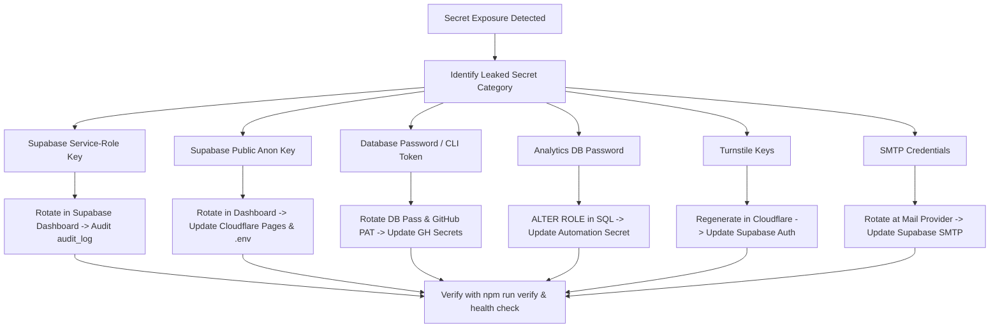
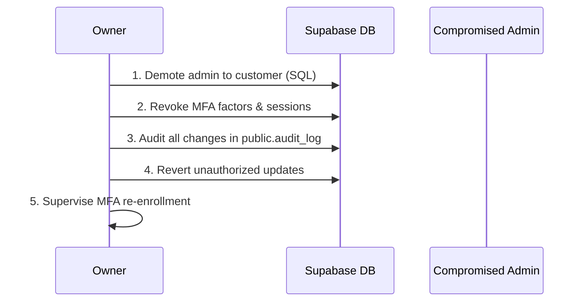

# Incident response and key rotation runbook

- Status: active
- Task: T-7.10
- Reference: `docs/spec/security-model.md` Section 8, 11
- Applies to: Production and staging environments (Cloudflare Pages, Supabase, GitHub, operational accounts)

This runbook establishes mandatory operating procedures for detecting, containing, investigating, and recovering from security incidents affecting the Lolys' Accessories & Home platform.

---

## 1. Incident severity classification

Every incident must be classified immediately upon discovery to dictate the response pace, escalation path, and notification urgency.

| Severity             | Description                                                                                                                           | Target response  | Escalation                                                   | Examples                                                                                                        |
| -------------------- | ------------------------------------------------------------------------------------------------------------------------------------- | ---------------- | ------------------------------------------------------------ | --------------------------------------------------------------------------------------------------------------- |
| **SEV-1 (Critical)** | Active compromise of admin account, payment redirection (QR swap), mass data exfiltration, or total production outage.                | **< 15 minutes** | Immediate call/SMS to Owner; freeze storefront if necessary. | Fraudulent InstaPay QR uploaded; service-role key leaked; unauthorized admin created in database.               |
| **SEV-2 (High)**     | Potential credential exposure, high-risk vulnerability actively exploitable, suspicious bulk DB queries, or SMTP provider compromise. | **< 1 hour**     | Notify Owner via primary secure channel.                     | GitHub Personal Access Token leaked; customer reports receiving password reset spam; Turnstile bypass detected. |
| **SEV-3 (Moderate)** | Non-critical security control failure, isolated client-side bug, or failed credential stuffing attack.                                | **< 4 hours**    | Log in security tracker; alert Owner during business hours.  | Rate-limit trigger anomalies; CSP violation report spike; single user login lockout.                            |
| **SEV-4 (Low)**      | Informational security observation, routine audit finding, or automated scanner warning.                                              | **< 24 hours**   | Next scheduled review / backlog triage.                      | Dependabot non-exploitable advisory; staging scanner warning.                                                   |

---

## 2. The first 15 minutes: Emergency containment protocol

When a critical security event (SEV-1) is identified, containment takes precedence over investigation. Execute the following actions in sequence:

### Step 2.1: Revoke all active user and admin sessions

Terminate all live JWT sessions and refresh tokens globally to eject any active attacker:

```sql
-- Connect via Supabase SQL Editor or psql with direct database connection:
-- 1. Invalidate all active refresh tokens
DELETE FROM auth.refresh_tokens;

-- 2. Invalidate all session records
DELETE FROM auth.sessions;

-- 3. Force token expiration timestamp for all users
UPDATE auth.users
SET raw_app_meta_data = raw_app_meta_data || '{"revoked_at": "' || extract(epoch from now())::text || '"}'::jsonb;
```

_Result:_ Every client (customer and admin) is immediately disconnected on their next request and forced to re-authenticate.

---

### Step 2.2: Switch storefront to emergency maintenance mode

If the web storefront or checkout flow is compromised (e.g., malicious script injection or corrupted settings):

1. **Via Cloudflare Pages Dashboard:**
   - Navigate to **Workers & Pages** -> **lolys** -> **Settings** -> **Maintenance**.
   - Enable maintenance mode, or activate the Cloudflare Maintenance Rule (returning a static 503 response with the Lolys brand maintenance page).

2. **Via Database Shop Settings:**
   Disable payment methods to prevent financial orders while keeping the catalog browse-only:

   ```sql
   UPDATE public.shop_settings
   SET value = 'false'
   WHERE key IN ('enable_cod', 'enable_instapay');
   ```

3. **Temporary Cloudflare WAF Block (Under Attack Mode):**
   - In Cloudflare Dashboard -> **Security** -> **Settings**, toggle **Security Level** to **"I'm Under Attack!"**.
   - This enforces a managed challenge before any HTTP traffic reaches the static frontend.

---

### Step 2.3: Disable new customer registrations

If bot sign-ups, credential stuffing, or mass fake accounts are flooding the database:

1. **Via Supabase Dashboard:**
   - Go to **Authentication** -> **Sign In / Up Providers** -> **Email**.
   - Toggle **"Allow new users to sign up"** to **Off**.
   - Click **Save**.

2. **Via Database Trigger (Instant hard stop):**
   ```sql
   CREATE OR REPLACE FUNCTION public.emergency_block_signups()
   RETURNS trigger LANGUAGE plpgsql AS $$
   BEGIN
     RAISE EXCEPTION 'Registration temporarily disabled for maintenance' USING ERRCODE = '54000';
   END;
   $$;

   DROP TRIGGER IF EXISTS tr_emergency_block_signups ON auth.users;
   CREATE TRIGGER tr_emergency_block_signups
     BEFORE INSERT ON auth.users
     FOR EACH ROW EXECUTE FUNCTION public.emergency_block_signups();
   ```

---

## 3. Keys and secrets rotation handbook

This section defines the exact, step-by-step rotation procedures for all six credentials documented in `docs/spec/security-model.md` Section 8.



### 3.1: Supabase secret (service-role) key

> [!CAUTION]
> The Lolys architecture **strictly forbids** using the `service_role` key in application code, client bundles, or repository files. If this key is exposed, an attacker could bypass all Row Level Security (RLS) policies.

1. **Rotate in Supabase:**
   - Log into [Supabase Dashboard](https://supabase.com/dashboard).
   - Navigate to **Project Settings** -> **API**.
   - In the **Project API keys** section, locate `service_role (secret)`.
   - Click **Generate new secret key**.
   - Choose whether to revoke the previous key immediately or allow a 24-hour transition window (select **Revoke immediately** during an active breach).
2. **Audit Exposure:**
   - Review PostgreSQL logs for unexpected `REST / SQL` calls authenticated with the service role:
     ```sql
     SELECT * FROM public.audit_log
     WHERE actor_role = 'service_role' OR actor_id IS NULL
     ORDER BY created_at DESC;
     ```
   - Check if any records in `public.orders`, `public.profiles`, or `public.shop_settings` were modified or deleted.

---

### 3.2: Supabase public (anon / publishable) key

The anon key identifies requests to Supabase and is intentionally exposed to client browsers. Access is strictly constrained by Row Level Security (RLS).

1. **Rotate in Supabase:**
   - Go to **Project Settings** -> **API**.
   - In the **Project API keys** section, click **Generate new key** next to `anon (public)`.
2. **Update Cloudflare Pages Production Environment:**
   - Go to [Cloudflare Dashboard](https://dash.cloudflare.com) -> **Workers & Pages** -> **lolys** -> **Settings** -> **Environment variables**.
   - Update `VITE_SUPABASE_ANON_KEY` for Production and Preview environments with the new key.
   - Trigger a new deployment: Go to **Deployments** -> **Retry deployment** (or push a documentation commit) so the client bundle builds with the new key.
3. **Verify:**
   - Inspect client browser network requests on `https://lolys.pages.dev/` to confirm HTTP requests use the new anon key header.

---

### 3.3: Database password and GitHub CLI access token

Controls direct database connections and automated migration deployments (`.github/workflows/db-staging.yml` and `db-production.yml`).

1. **Rotate Database Password:**
   - In Supabase Dashboard -> **Project Settings** -> **Database**.
   - Scroll to **Database password** and click **Reset database password**.
   - Generate a strong, random 32+ character password.
   - Save the password securely in the owner's encrypted password manager.
2. **Rotate Supabase Personal Access Token (for CLI migrations):**
   - In Supabase Dashboard -> Click your profile avatar (top right) -> **Account** -> **Access Tokens**.
   - Delete the compromised token.
   - Click **Generate new token** with name `lolys-ci-deploy`.
3. **Update GitHub Repository Secrets:**
   - In GitHub -> **Settings** -> **Secrets and variables** -> **Actions**.
   - Update:
     - `SUPABASE_ACCESS_TOKEN`: The newly generated personal access token.
     - `SUPABASE_DB_PASSWORD_STAGING`: The staging DB password (if affected).
     - `SUPABASE_DB_PASSWORD_PRODUCTION`: The production DB password.
4. **Verify Deployment Pipeline:**
   - Run workflow dispatch on `db-staging.yml` to verify connectivity without deploying changes.

---

### 3.4: Analytics database role password

Controls the read-only reporting role `lolys_analytics`.

1. **Rotate via SQL (Owner connection only):**
   ```sql
   -- Generate a random 32-character secret
   ALTER ROLE lolys_analytics WITH PASSWORD 'new-strong-random-password-here';
   ```
2. **Update Secrets:**
   - In GitHub repository secrets or local runner environment, update `ANALYTICS_DB_PASSWORD`.
3. **Verify:**
   - Run `npm run analytics:test` to confirm the analytics suite authenticates with the updated password.

---

### 3.5: Cloudflare Turnstile site key and secret key

Provides CAPTCHA and anti-bot protection on sign-in, registration, and password reset.

1. **Rotate in Cloudflare:**
   - Log into Cloudflare Dashboard -> **Turnstile**.
   - Click **Add Widget** (or select the existing Lolys widget -> **Settings** -> **Rotate Secret**).
   - Set Domain allowlist: `lolys.pages.dev`, `staging.lolys.pages.dev`, `localhost`.
   - Copy the new **Site Key** and **Secret Key**.
2. **Update Client Environment:**
   - In Cloudflare Pages -> **Environment variables**, update `VITE_TURNSTILE_SITE_KEY`.
3. **Update Supabase Auth (Server Verification):**
   - In Supabase Dashboard -> **Authentication** -> **Bot Protection** -> **Turnstile**.
   - Enter the new **Turnstile Secret Key**.
   - Click **Save**.
4. **Verify:**
   - Test sign-in at `/login` to confirm the challenge resolves without `AUTH-003` errors.

---

### 3.6: Custom SMTP credentials

Controls automated transactional emails (verification emails and password resets).

1. **Rotate with Email Provider:**
   - Log into the SMTP provider console (e.g., Resend, SendGrid, Amazon SES).
   - Generate a new SMTP API key / password.
   - Revoke the compromised SMTP credential.
2. **Update Supabase Auth SMTP Configuration:**
   - In Supabase Dashboard -> **Project Settings** -> **Authentication** -> **SMTP Settings**.
   - Update the **SMTP Password** (and username if rotated).
   - Send a test email from the dashboard to verify delivery.
3. **Audit Outbound Volume:**
   - Inspect provider dashboard for unusual spikes in email volume or bounce rates that might indicate unauthorized mail relay.

---

## 4. Disaster recovery and database restore procedure

### 4.1: Point-In-Time Recovery (PITR) in Supabase

For production databases running on Supabase Pro/Team plans:

1. In Supabase Dashboard -> **Project Settings** -> **Database** -> **Backups**.
2. Select **Point in Time**.
3. Choose the target timestamp immediately prior to the compromise or corruption event.
4. Select **Restore to a new project** (always restore to an isolated target first to verify data before cutting traffic over).
5. Verify customer orders, profiles, and audit log entries on the restored instance.

### 4.2: Manual logical backup restore (pg_restore)

If restoring from an automated daily logical backup:

```powershell
# 1. Download the latest verified backup from secure off-site storage:
# lolys-backup-YYYY-MM-DD-HHMM.dump

# 2. Test restore on a clean local or staging database first:
$env:PGPASSWORD = "your-staging-db-password"
pg_restore --clean --if-exists --no-owner --no-privileges `
  -h "db.your-staging-ref.supabase.co" `
  -p 5432 `
  -U "postgres" `
  -d "postgres" `
  "lolys-backup-YYYY-MM-DD-HHMM.dump"

# 3. Verify schema and security guards:
npm run db:test
npm run check:sql
```

---

## 5. Specific incident playbooks

### Playbook A: Suspected compromised or stolen admin account

**Indicators:**

- Unrecognized logins in auth logs.
- Sensitive changes in `public.audit_log` from an admin account during unusual hours.
- Customer complaints about altered order statuses or missing refunds.



**Step-by-step remediation:**

1. **Immediate demotion (Revoke admin privilege):**

   ```sql
   -- Connect via SQL Editor (Owner only)
   UPDATE public.profiles
   SET role = 'customer'
   WHERE id = '<compromised-user-uuid>';
   ```

   _Impact:_ Because `is_admin()` requires `role = 'admin'` and `AAL2`, the account immediately loses all admin access.

2. **Evict all active sessions and MFA factors:**

   ```sql
   DELETE FROM auth.mfa_factors WHERE user_id = '<compromised-user-uuid>';
   DELETE FROM auth.sessions WHERE user_id = '<compromised-user-uuid>';
   DELETE FROM auth.refresh_tokens WHERE session_id IN (
     SELECT id FROM auth.sessions WHERE user_id = '<compromised-user-uuid>'
   );
   ```

3. **Lock auth account (Disable login):**

   ```sql
   UPDATE auth.users
   SET banned_until = '2099-01-01 00:00:00+00'
   WHERE id = '<compromised-user-uuid>';
   ```

4. **Forensic audit in `public.audit_log`:**
   Inspect every action taken by the actor:

   ```sql
   SELECT
     created_at, entity, entity_id, action,
     old_data, new_data
   FROM public.audit_log
   WHERE actor_id = '<compromised-user-uuid>'
   ORDER BY created_at DESC;
   ```

   Review specifically:
   - Price updates on products.
   - Status changes on orders (e.g. marking unpaid orders as `paid`).
   - Settings updates (especially `instapay_qr_path` or `instapay_handle`).

5. **Revert unauthorized changes:**
   Using the `old_data` snapshots recorded by the immutable audit triggers, revert each modified record to its pre-incident state.

6. **Re-onboarding:**
   The admin user must only be reinstated after a fresh device inspection, password reset, and physical second-device TOTP enrollment witnessed by the owner.

---

### Playbook B: Malicious payment tampering (InstaPay QR swapped)

**Indicators:**

- Customers report payments sent to an unfamiliar InstaPay address.
- `public.audit_log` records an update to `shop_settings.instapay_qr_path` or `shop_settings.instapay_handle`.
- Unrecognized images in the `product-images/settings/` storage path.

**Step-by-step remediation:**

1. **Immediate payment freeze:**

   ```sql
   -- Disable InstaPay immediately
   UPDATE public.shop_settings
   SET value = 'false'
   WHERE key = 'enable_instapay';
   ```

2. **Identify the exact compromise window:**

   ```sql
   SELECT created_at, actor_id, old_data, new_data
   FROM public.audit_log
   WHERE entity = 'shop_settings'
     AND (old_data->>'key' LIKE '%instapay%' OR new_data->>'key' LIKE '%instapay%')
   ORDER BY created_at DESC;
   ```

   Note the `compromised_at` timestamp and the rogue handle/QR path.

3. **Restore legitimate payment credentials:**

   ```sql
   -- Reset to verified official merchant handle and QR path
   UPDATE public.shop_settings
   SET value = 'lolys@instapay' -- or official merchant handle
   WHERE key = 'instapay_handle';

   UPDATE public.shop_settings
   SET value = 'settings/official_instapay_qr.webp'
   WHERE key = 'instapay_qr_path';
   ```

4. **Identify all affected orders and customers:**

   ```sql
   SELECT
     o.id AS order_id,
     o.user_id,
     o.total,
     o.created_at,
     o.payment_reference,
     o.ship_name,
     o.ship_phone,
     p.phone AS customer_phone
   FROM public.orders o
   JOIN public.profiles p ON p.id = o.user_id
   WHERE o.payment_method = 'instapay_qr'
     AND o.created_at >= '<compromised_at_timestamp>'
   ORDER BY o.created_at ASC;
   ```

5. **Customer restitution and support:**
   - **Do not penalize the customer:** Any customer who paid the fraudulent handle during the compromise window was acting in good faith based on the platform's compromised display.
   - Contact each affected customer via phone / WhatsApp.
   - Verify their transfer receipt.
   - Manually mark their order as `paid` and confirmed:
     ```sql
     UPDATE public.orders
     SET payment_status = 'paid', status = 'confirmed', paid_at = now()
     WHERE id = <order_id>;
     ```
   - Absorb the financial loss as an operational incident expense.

6. **Legal & Cybercrime reporting:**
   - File a report with the Egyptian Ministry of Interior General Administration for Information Technology (مباحث الإنترنت / Cybercrime Unit) regarding the fraudulent InstaPay handle and transaction references.
   - Notify the receiving bank / Egyptian Central Bank InstaPay fraud desk regarding the fraudulent recipient account.

---

## 6. Communications and notification protocol

### 6.1: Legal disclosure (Egyptian Data Protection Law No. 151 of 2020)

Under Egyptian Personal Data Protection Law (Law 151 of 2020), personal data breaches must be reported to the Personal Data Protection Centre (مركز حماية البيانات الشخصية) within **72 hours** if the breach poses a risk to data subjects' rights and privacy.

**Contact Points:**

- **Regulatory Authority:** Personal Data Protection Centre (PDPC) / Ministry of Communications and Information Technology (MCIT).
- **Required Report Data:**
  - Nature and date of the incident.
  - Categories and approximate number of affected customers.
  - Probable consequences of the breach.
  - Measures taken or proposed to mitigate negative effects.

### 6.2: Customer communication template (Arabic & English)

#### Arabic (Primary communication language):

> **الموضوع: إشعار هام بشأن أمان حسابك في متجر لوليز**
>
> عزيزنا العميل،
>
> نحرص في متجر لوليز للإكسسوارات والمنزل على وضع أمان بياناتك وشفافيتنا معك في المقام الأول.
>
> بتاريخ [تاريخ الواقعة]، رصد فريق الأمان لدينا [وصف موجز ومحدد للحادث، مثل: نشاطًا غير مصرح به على أحد أنظمتنا / محاولة استبدال وسيلة الدفع].
>
> نود التأكيد على الحقائق التالية:
>
> - **بياناتك المالية آمنة تمامًا:** متجر لوليز لا يقوم أبدًا بتخزين أي أرقام بطاقات بنكية أو بيانات حسابات مصرفية، حيث تتم كافة التحويلات حصريًا من خلال تطبيق البنك الخاص بك.
> - **كلمات المرور مشفرة:** لم يتم تسريب أي كلمات مرور بنص غير مشفر.
> - **الطلبات المتأثرة:** [إن وُجدت: لن يتحمل أي عميل أية خسائر مالية، وقد تواصلنا بالفعل مع العملاء المعنيين مباشرة].
>
> **الإجراءات التي اتخذناها:**
>
> 1. إيقاف وإغلاق الثغرة فور رصدها خلال دقائق.
> 2. إلغاء كافة الجلسات النشطة وتحديث كافة مفاتيح الأمان.
> 3. تعزيز آليات التحقق الثنائي والمراقبة الصارمة للعمليات.
>
> إذا كانت لديك أي استفسارات، نرجو عدم التردد في التواصل مع فريق الدعم مباشرة عبر واتساب: [رقم الدعم] أو البريد الإلكتروني: support@lolys.com.
>
> شكرًا لثقتكم بنا،  
> **فريق أمان متجر لوليز**

#### English:

> **Subject: Important notice regarding your Lolys account security**
>
> Dear Customer,
>
> At Lolys' Accessories & Home, protecting your personal data and maintaining transparency with you is our highest priority.
>
> On [Incident Date], our security team detected [brief, specific incident description, e.g., unauthorized activity affecting an internal service / an attempt to modify payment routing].
>
> We wish to confirm the following facts:
>
> - **Your financial data is completely secure:** Lolys never stores debit/credit card numbers or banking account credentials; all electronic transfers take place exclusively inside your bank's official application.
> - **Passwords remain protected:** No passwords were exposed in plaintext or compromised.
> - **Affected orders:** [If applicable: Zero customers will bear financial loss; we have already reached out directly to each affected customer].
>
> **Actions taken:**
>
> 1. Contained and closed the vulnerability within minutes of detection.
> 2. Revoked all active user and admin sessions and rotated security credentials.
> 3. Enforced enhanced two-factor authentication and continuous transaction audit monitoring.
>
> If you have questions or require assistance, please reach out to our support team directly via WhatsApp: [Support Phone] or email: support@lolys.com.
>
> Thank you for your trust,  
> **Lolys Security Team**

---

## 7. Post-Incident Review (PIR) template

Within **5 business days** of resolving any SEV-1 or SEV-2 incident, the engineering team and owner must conduct a blameless Post-Incident Review using this template:

```markdown
# Post-Incident Review: [Incident Title]

- **Incident Date:** YYYY-MM-DD
- **Severity:** [SEV-1 / SEV-2 / SEV-3]
- **Lead Investigator:** [Name]
- **Incident Commander:** [Name]
- **Status:** [Resolved / Actions Pending]

## 1. Executive summary

[Brief 2-3 paragraph summary of what happened, customer impact, root cause, and how it was resolved.]

## 2. Impact assessment

- **Duration:** [X hours Y minutes]
- **Affected Customers:** [Number of users affected]
- **Affected Orders:** [Number of orders, total financial value in EGP]
- **Data Exposed:** [Categories of data, e.g. names/phones, or None]
- **Downtime:** [Minutes of site unavailability]

## 3. Timeline (All times in Africa/Cairo, UTC+3)

- `YYYY-MM-DD HH:MM` - Incident begins (earliest evidence)
- `YYYY-MM-DD HH:MM` - Detection (alert fired / report received)
- `YYYY-MM-DD HH:MM` - First response / triage begins
- `YYYY-MM-DD HH:MM` - Containment action taken (e.g. sessions revoked)
- `YYYY-MM-DD HH:MM` - Root cause identified
- `YYYY-MM-DD HH:MM` - Fix deployed / verified
- `YYYY-MM-DD HH:MM` - Normal operations restored

## 4. Root cause analysis (The 5 Whys)

1. Why did the issue occur? -> [Answer]
2. Why was that possible? -> [Answer]
3. Why was that not prevented? -> [Answer]
4. Why did existing controls not catch it earlier? -> [Answer]
5. Why was the root design vulnerable? -> [Answer]

## 5. What went well

- [Item 1]
- [Item 2]

## 6. What went wrong / areas for improvement

- [Item 1]
- [Item 2]

## 7. Preventative action items

| Action item                                  | Category   | Owner    | Due date   | Tracking issue |
| -------------------------------------------- | ---------- | -------- | ---------- | -------------- |
| Implement automated alert for QR code change | Monitoring | Engineer | YYYY-MM-DD | #123           |
| Enforce IP rate-limiting on staging          | Security   | Engineer | YYYY-MM-DD | #124           |
```

---

## 8. Tabletop rehearsal and verification log

Tabletop drills rehearse emergency containment procedures without modifying production databases.

| Date           | Scenario                                   | Participants                 | Observations & Findings                                                                                                                                                                                                                                                                                                                                  | Status   |
| -------------- | ------------------------------------------ | ---------------------------- | -------------------------------------------------------------------------------------------------------------------------------------------------------------------------------------------------------------------------------------------------------------------------------------------------------------------------------------------------------- | -------- |
| **2026-10-14** | **Tabletop Drill: Stolen Admin & QR Swap** | Anti-Gravity (review), Codex | Validated emergency session revocation SQL; verified that demoting an admin in `profiles` immediately blocks admin RPC calls due to `is_admin()` checking both role and AAL2 claim; verified that `shop_settings` audit triggers record any changes to `instapay_qr_path` with before/after payloads. Confirmed runbook procedures are fully actionable. | **PASS** |
