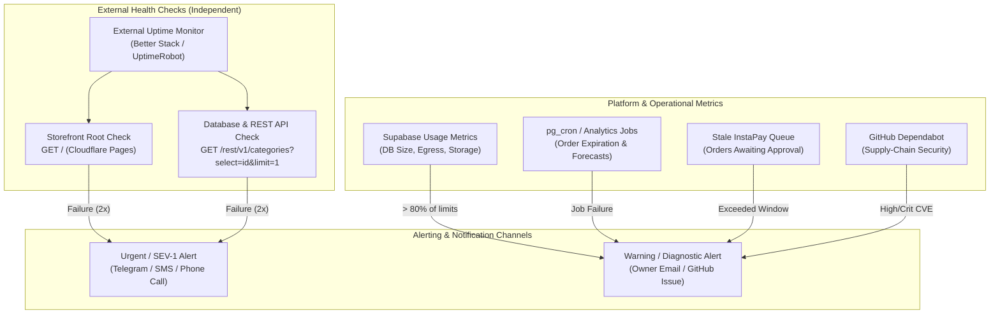
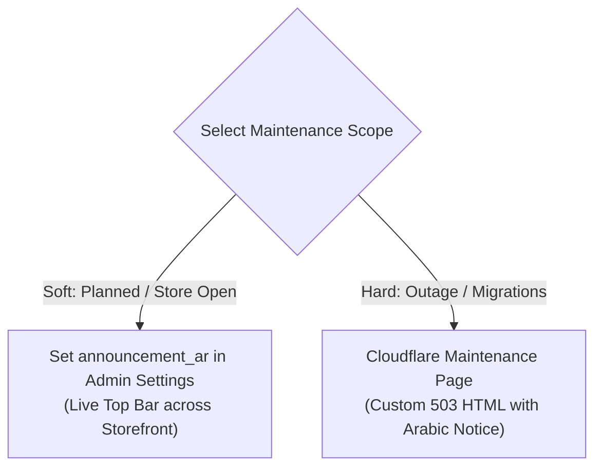

# Runbook: Monitoring, Alerting, and Plan-Decision Memo

Applies to roadmap task **T-8.07**, open decisions **O-09** (Error and uptime monitoring) and **O-11** (Supabase plan at launch), and production operations.

---

## 1. Overview and Architecture

The Lolys monitoring architecture is designed for simplicity, high signal-to-noise ratio, zero client-side tracking, and strict adherence to initial bundle size constraints (<= 200 KB gzip).



### 1.1 Decision O-09: No Client-Side Error Telemetry at Launch

Per Open Decision **O-09**, client-side third-party error tracking SDKs (e.g., Sentry, Bugsnag, Datadog) are **deliberately excluded** from the client bundle at launch:

- **Bundle Budget Preservation:** Sentry browser SDK adds ~35–45 KB (minified + gzipped), which would breach our strict 200,000 gzip byte entry budget (currently optimized at 199,850 bytes).
- **Privacy Assurance:** Prevents accidental leakage of customer PII (Egyptian Law 151 of 2020) to overseas telemetry providers.
- **Observability Alternative:** Centralized PostgreSQL logs in the Supabase Dashboard, Cloudflare Pages analytics, and external synthetic uptime probes provide complete, reliable visibility without client bundle overhead.

---

## 2. External Synthetic Uptime Monitoring

An external monitoring service (such as Better Stack / Better Uptime or UptimeRobot) must be configured by the owner to probe the site every **3 to 5 minutes** from multiple geographic regions (including Europe and Middle East).

### 2.1 Monitor 1: Storefront Frontend (Cloudflare Pages)

- **Target URL:** `https://lolys.pages.dev` (or production custom domain per O-08).
- **Method:** `GET`
- **Expected Status:** `200 OK`
- **Response Validation:** Response body must contain `<div id="root">` or `<title>Lolys</title>`.
- **Check Frequency:** Every 3 minutes.
- **Failure Threshold:** 2 consecutive failures across 2 different locations before dispatching an alert.

### 2.2 Monitor 2: Lightweight Database & REST API (Supabase)

Probing PostgREST directly tests the full path: Cloudflare network -> Supabase API Gateway -> PostgREST -> PostgreSQL database engine.

- **Target URL:** `https://<production-ref>.supabase.co/rest/v1/categories?select=id&limit=1`
- **Method:** `GET`
- **Headers:**
  ```http
  apikey: <PRODUCTION_ANON_KEY>
  Authorization: Bearer <PRODUCTION_ANON_KEY>
  ```
- **Expected Status:** `200 OK`
- **Response Validation:** Valid JSON array (`[{...}]`).
- **Check Frequency:** Every 5 minutes.
- **Failure Threshold:** 2 consecutive failures.

---

## 3. Operational Alerting Specifications

Five critical operational conditions require automated notification to the shop owner and engineering lead:

| Alert ID   | Condition                     | Trigger Threshold                                              | Channel                          | Action Procedure                                                         |
| ---------- | ----------------------------- | -------------------------------------------------------------- | -------------------------------- | ------------------------------------------------------------------------ |
| **ALT-01** | **Site or API Down**          | 2 consecutive failed health checks on Monitor 1 or Monitor 2   | Urgent (Telegram / Phone / Push) | Follow `docs/runbooks/incident-response.md` (SEV-1 triage).              |
| **ALT-02** | **Supabase Usage High**       | Database storage or monthly egress > 80% of plan quotas        | Email / Notification             | Upgrade plan quota or execute data retention purge (O-14).               |
| **ALT-03** | **Analytics / Cron Failure**  | `forecast_runs` status `failed` or `pg_cron` execution failure | Email / Engineering channel      | Run fallback forecast or trigger manual SQL procedure (`T-9.12`).        |
| **ALT-04** | **Dependabot Security Alert** | High or Critical severity vulnerability detected               | Email / GitHub Security tab      | Follow `docs/runbooks/dependencies.md` emergency triage protocol.        |
| **ALT-05** | **Stale InstaPay Queue**      | Unreviewed orders in `awaiting_approval` > 24 hours            | Email / Admin Badge              | Admin reviews pending queue at `/admin/orders?status=awaiting_approval`. |

### 3.1 Database Capacity Query (> 80% Usage Guard)

Run periodically or via scheduled SQL check to measure database table footprint:

```sql
-- Check total database size against plan limit (500 MB for Free, 8 GB for Pro)
SELECT
  pg_size_pretty(pg_database_size(current_database())) AS current_db_size,
  round((pg_database_size(current_database())::numeric / (500 * 1024 * 1024)) * 100, 2) AS pct_of_free_tier,
  round((pg_database_size(current_database())::numeric / (8192::numeric * 1024 * 1024)) * 100, 2) AS pct_of_pro_tier;
```

### 3.2 Stale Orders Health Query

```sql
-- Identifies InstaPay orders awaiting admin review beyond the 24-hour approval window
SELECT id, customer_id, created_at, total
FROM public.orders
WHERE status = 'awaiting_approval'
  AND created_at < (now() - interval '24 hours')
ORDER BY created_at ASC;
```

---

## 4. Maintenance Mode Procedures

When performing disruptive database updates, emergency hotfixes, or incident containment, maintenance messaging can be applied at two levels:



### 4.1 Soft Maintenance Mode: Announcement Bar

When the shop remains open but experiencing delays (e.g., courier strikes, holiday processing, scheduled night maintenance):

1. Navigate to `/admin/settings` (Site Settings).
2. In the **شريط الإعلانات** (`announcement_ar`) field, enter the customer notice:
   - _Example:_ `تنبيه: نجري تحسينات تقنية الليلة من الساعة 2 إلى 3 صباحًا. قد تواجه تأخرًا بسيطًا في تأكيد الطلبات.`
3. Save changes. The announcement bar renders immediately across all storefront pages.
4. To remove, clear the input field and save.

### 4.2 Hard Maintenance Mode: Cloudflare Pages 503

During major database schema restores, secret rotations, or severe network incidents:

1. Log into the Cloudflare Dashboard -> **Workers & Pages**.
2. Route traffic to a Maintenance Worker returning `HTTP 503 Service Unavailable` with a branded Arabic message:
   ```html
   <!DOCTYPE html>
   <html dir="rtl" lang="ar">
     <head>
       <meta charset="utf-8" />
       <title>Lolys - المتجر في وضع الصيانة المؤقتة</title>
       <style>
         body {
           font-family: system-ui, sans-serif;
           text-align: center;
           padding: 10% 5%;
           background: #faf7f2;
           color: #2d2422;
         }
         h1 {
           color: #8a4b58;
           font-size: 2rem;
         }
         p {
           font-size: 1.15rem;
           line-height: 1.8;
         }
       </style>
     </head>
     <body>
       <h1>المتجر في وضع الصيانة المؤقتة</h1>
       <p>
         نقوم حاليًا بإجراء بعض التحديثات الدورية لتحسين تجربة التسوق.<br />سنعود للعمل قريبًا جدًا،
         شكرًا لتفهمكم!
       </p>
     </body>
   </html>
   ```

---

## 5. Plan-Decision Memo (Open Decision O-11)

**Date:** 2026-10-14  
**Author:** Anti-Gravity / Codex  
**Recipient:** Shop Owner  
**Decision Reference:** **O-11: Supabase Platform Tier for Launch**

### 5.1 Executive Summary

The Lolys platform requires reliable PostgreSQL database hosting with strict Row Level Security, transactional order placement (`place_order`), and authenticated image storage.

This memo evaluates the **Supabase Free Plan ($0/mo)** versus the **Supabase Pro Plan ($25/mo)** against business risks, data safety, operational overhead, and launch readiness.

### 5.2 Comparative Feature and Cost Matrix

| Evaluation Dimension       | Supabase Free Plan                                                                    | Supabase Pro Plan ($25 / month)                            | Impact on Lolys Operations                                                              |
| -------------------------- | ------------------------------------------------------------------------------------- | ---------------------------------------------------------- | --------------------------------------------------------------------------------------- |
| **Monthly Subscription**   | **$0**                                                                                | **$25 USD** (~1,220 EGP/mo)                                | Predictable baseline expense for commercial retail business.                            |
| **Inactivity Pausing**     | **Pauses after 7 days** without traffic.<br/>Requires keep-alive workflow (`T-8.05`). | **Never pauses.**<br/>Always online.                       | **HIGH RISK on Free:** If keep-alive misses, customers see broken site; checkout fails. |
| **Automated Backups**      | **None.** Zero automated platform backups.                                            | **Daily automated physical backups** with 7-day retention. | **CRITICAL on Free:** Requires owner to manually run `pg_dump` every week.              |
| **Point-In-Time Recovery** | Not available.                                                                        | Optional add-on ($100/mo).                                 | Daily snapshots provide adequate RPO (< 24h) for launch.                                |
| **Database Space**         | 500 MB included.                                                                      | 8 GB included ($0.125 / additional GB).                    | 500 MB holds ~50,000 orders; 8 GB provides years of runway.                             |
| **File Storage**           | 1 GB included.                                                                        | 100 GB included ($0.021 / additional GB).                  | High-res product images and payment proofs quickly exceed 1 GB.                         |
| **Monthly Active Users**   | 50,000 MAU.                                                                           | 100,000 MAU.                                               | Sufficient for storefront traffic.                                                      |
| **Egress Bandwidth**       | 2 GB / month.                                                                         | 250 GB / month ($0.09 / additional GB).                    | **HIGH RISK on Free:** 2 GB egress can be exhausted by ~2,000 image views.              |
| **Technical Support**      | Community Discord only.                                                               | Email support with dedicated ticket SLA.                   | Necessary for transactional commerce and payment issues.                                |
| **Custom Domain on Auth**  | Extra cost / limitations.                                                             | Custom Auth Domain supported.                              | Professional branding for email confirmations.                                          |

### 5.3 Risk Assessment of Launching on the Free Plan

1. **Auto-Pausing Outage Risk:** While task `T-8.05` provides a weekly automated GitHub Actions keep-alive pulse (`keepalive.yml`), relying on a synthetic scheduled query for a live e-commerce business carrying real money and customer payments is fragile.
2. **Bandwidth / Egress Exhaustion:** Free tier limits monthly egress to **2 GB**. With an average product gallery payload of ~500 KB to 1 MB per shopping session, as few as 2,000 customer visits in a month would exhaust the egress quota, causing image loading failures across Egypt.
3. **Absence of Disaster Recovery:** A corrupted table or accidental admin error on the Free plan cannot be restored from a platform snapshot—it relies entirely on whether the owner manually remembered to execute a logical dump.

### 5.4 Recommendation and Action Plan

> [!IMPORTANT]
> **Definitive Recommendation (O-11): Adopt Supabase Pro Plan ($25/mo) for Production at Launch.**
>
> - **Production Environment:** Upgrade project to **Supabase Pro Tier ($25/month)**.
> - **Staging Environment:** Remain on **Supabase Free Tier ($0/month)**.
> - **Local Development:** Remain on local Docker stack ($0/month).

#### Owner Action Items to Finalize O-11:

1. Log into [Supabase Dashboard](https://supabase.com/dashboard/project/_/settings/billing/subscription).
2. Select the **Production** project (`lolys-production`).
3. Click **Upgrade to Pro** ($25/month).
4. Verify under **Project Settings -> Database -> Backups** that Daily Backups are enabled.
5. In `.github/workflows/keepalive.yml`, the keep-alive ping can remain active or be marked `skip` in `roadmap.md` once Pro is activated.
