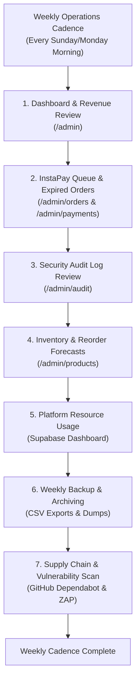
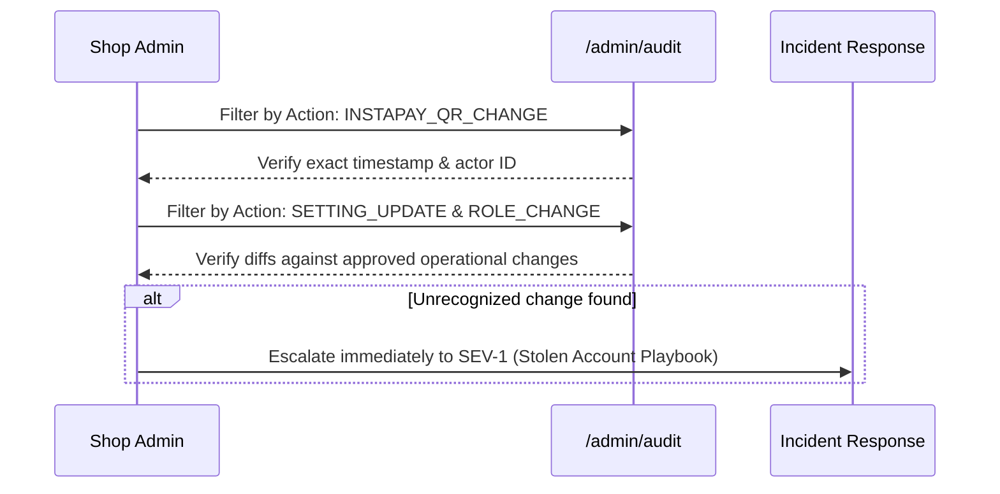
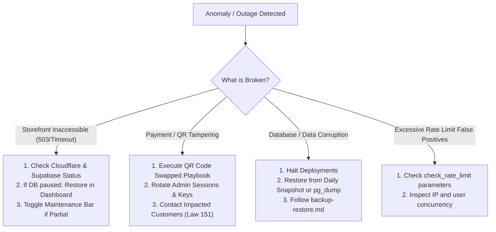

# Runbook: Weekly Shop Operations and Maintenance

Applies to roadmap task **T-8.11**, operational procedures, and ongoing shop management.

---

## 1. Overview & Weekly Schedule

This runbook guides the shop owner and administrators through the routine weekly operational cadence. Performing these checks every **Sunday or Monday morning** ensures financial reconciliation, inventory replenishment, data security, platform stability, and compliance with statutory retention requirements.



---

## 2. Step 1: Admin Dashboard & Financial Review

Navigate to `/admin` and log in with your primary admin account (enforcing TOTP MFA).

### 2.1 Core Metrics Check

1. **Total Revenue (EGP):** Compare current week gross revenue against previous week.
2. **Order Volume & Fulfillment:** Review pending vs confirmed vs shipped orders.
3. **Average Order Value (AOV):** Monitor basket sizes for pricing anomalies.
4. **Daily Sales Chart:** Verify daily sales volume curves. If sharing report with accountants, click **طباعة التقرير** (Print Report) or export the daily series via CSV (`T-6.03`).

---

## 3. Step 2: Pending and Expired InstaPay Orders

InstaPay bank transfers require active administrative oversight to prevent stock reservation lockups.

### 3.1 Reviewing Orders Awaiting Approval (`awaiting_approval`)

1. Open `/admin/orders?status=awaiting_approval`.
2. Inspect orders submitted by customers:
   - Check delivery address and governorate coverage (`docs/runbooks/delivery-fees.md`).
   - Click **موافقة وإرسال عبر واتساب** (Approve & Send via WhatsApp) to open a pre-filled WhatsApp conversation with the customer providing payment instructions.
   - Or click **موافقة فقط** (Approve Only) if the customer will pay through the storefront.
3. If an order cannot be fulfilled (e.g., unreachable customer or remote area outside courier coverage), click **رفض الطلب** (Reject Order) and enter the mandatory cancellation reason. Stock is automatically restored.

### 3.2 Reviewing Orders Awaiting Proof (`awaiting_proof`)

1. Open `/admin/orders?payment_status=awaiting_proof`.
2. If an order has been awaiting payment proof for $> 12\text{ hours}$, send a friendly reminder via WhatsApp with the payment link (`wa.me/20...`).
3. **Expired Orders:** Orders that exceed the 24-hour payment window (O-06) are automatically cancelled and restocked by the `expire_unpaid_orders()` trigger.
   - If an order has expired but the customer presents proof of transfer afterwards, verify receipt in your InstaPay mobile app before manually marking confirmed.

### 3.3 Payment Review Queue (`/admin/payments`)

1. Review pending payment receipts in the queue sorted FIFO (oldest first).
2. Generate an ephemeral signed preview URL to view the customer receipt.
3. Verify transaction amount matches the order total in EGP.
4. Confirm transfer reference in your bank application, then click **تأكيد الدفع** (Confirm Payment).

---

## 4. Step 3: Security & Audit Log Review

Inspect sensitive events recorded in `public.audit_log` at `/admin/audit`:



### 4.1 Filter and Audit High-Risk Events

- [ ] **`INSTAPAY_QR_CHANGE`:** Ensure the QR code was only updated during authorized maintenance. If unapproved, immediately execute the _QR Code Swapped Playbook_ (`docs/runbooks/incident-response.md`).
- [ ] **`SETTING_UPDATE`:** Verify changes to delivery fees, pending order limits, or shop phone numbers.
- [ ] **`CUSTOMER_ANONYMIZE`:** Verify customer erasure requests match logged DSR tickets (`docs/runbooks/data-requests.md`).
- [ ] **`ADMIN_ADJUST`:** Audit unexplained inventory edits.

---

## 5. Step 4: Forecasts & Inventory Reorder List

Ensure fast-moving inventory is restocked before running out.

### 5.1 Low-Stock Identification

1. Navigate to `/admin/products?stock=low_stock`.
2. Review items with stock $\le 5$ units.
3. Review best sellers at `/admin/products?sort=sold_count_desc`.
4. Consult the AI/statistical demand forecast report (`docs/runbooks/analytics.md` / `T-9.12`) to evaluate anticipated 14-day demand.

### 5.2 Export Reorder Sheet

1. Click **تصدير المنتجات (CSV)** on `/admin/products`.
2. Complete Step-Up MFA TOTP verification.
3. Send the generated CSV to your suppliers or workshop craftsmen for restock fulfillment.

---

## 6. Step 5: Supabase Platform Resource Monitoring

Log into the [Supabase Dashboard](https://supabase.com/dashboard) and inspect project health:

| Metric                 | Warning Threshold (80%) | Maximum Limit (Pro Tier) | Action if Warning Reached                           |
| ---------------------- | ----------------------- | ------------------------ | --------------------------------------------------- |
| **Database Space**     | $> 6.4\text{ GB}$       | $8\text{ GB}$ included   | Upgrade compute storage or purge archived records.  |
| **Egress Bandwidth**   | $> 200\text{ GB}$       | $250\text{ GB}$ included | Review CDN caching and optimize asset sizes.        |
| **Storage Buckets**    | $> 80\text{ GB}$        | $100\text{ GB}$ included | Run 90-day payment proof purge (`/admin/payments`). |
| **Active Users (MAU)** | $> 80,000$              | $100,000$ included       | Review traffic spikes and consider plan scaling.    |

---

## 7. Step 6: Weekly Backup and Encrypted Archiving

Execute the weekly backup checklist per `docs/runbooks/backup-restore.md` (T-8.06):

1. **Admin CSV Exports (MFA Step-Up):**
   - Export Products: `/admin/products` -> `lolys-products-YYYY-MM-DD.csv`
   - Export Orders: `/admin/orders` -> `lolys-orders-YYYY-MM-DD.csv`
   - Export Customers: `/admin/customers` -> `lolys-customers-YYYY-MM-DD.csv`
   - Export Audit Log: `/admin/audit` -> `lolys-audit-YYYY-MM-DD.csv`
2. **Move to Encrypted Storage:** Save exported CSV files into the encrypted BitLocker/FileVault archive directory `Lolys-Backups/CSV-Exports/YYYY-MM/`.
3. **Verify Vendor Physical Snapshots:** Open Supabase Dashboard -> **Database** -> **Backups** to verify that automated daily snapshots are green and healthy.

---

## 8. Step 7: Supply-Chain & Security Vulnerability Check

1. **GitHub Dependabot:** Open repository **Security** tab -> **Dependabot alerts**. If any High or Critical CVEs are flagged, follow `docs/runbooks/dependencies.md`.
2. **Local Repository Verification:**
   ```powershell
   npm run check:supply-chain
   npm audit signatures
   npm run verify
   ```
3. **OWASP ZAP Scans:** Check the latest report generated by `.github/workflows/zap.yml` for emerging security header or configuration issues.

---

## 9. What to Do When Something Breaks (Triage & Emergency Playbook)



### 9.1 Emergency Escalation Checklist

1. **SEV-1 (Critical Business Interruption):**
   - Site completely down, payments compromised, or data breach suspected.
   - Immediately follow **First 15 Minutes Containment Protocol** in `docs/runbooks/incident-response.md`.
2. **Activating Maintenance Mode:**
   - **Soft Notice:** Enter customer notice into `announcement_ar` in `/admin/settings` (Site Settings).
   - **Hard Downtime:** Enable Cloudflare Pages 503 Worker (`docs/runbooks/monitoring.md` Section 4.2).
3. **Key Contacts:**
   - **Lead Engineer / Anti-Gravity:** Escalation via project repository / communications.
   - **Supabase Support:** `https://supabase.com/dashboard/support/new`.
   - **Cloudflare Status:** `https://www.cloudflarestatus.com/`.
